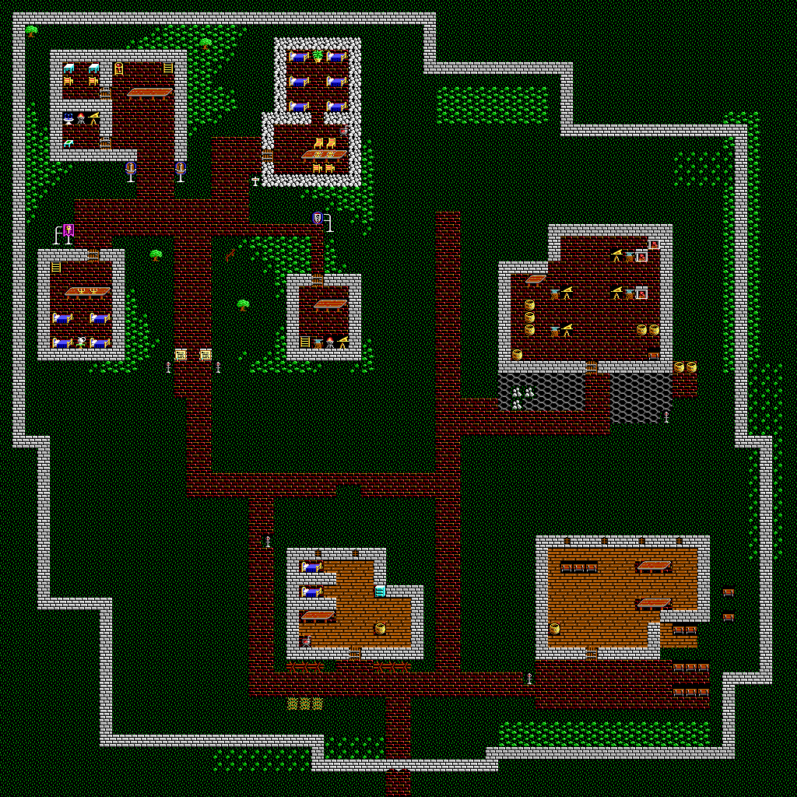

# Minoc: first industrial district experiment

**For human review, not a finished city or a game play-test.** The final map is
[`study/06-final.json`](study/06-final.json), with both floors expanded to 64×64.
To retain the bottom-center **arrival setting**, import the companion
[`Minoc-experiment.imperamod`](study/Minoc-experiment.imperamod) into a separate
Workshop project. Location JSON transfers terrain and gate records but has no
portal-arrival field. The companion uses the existing map catalogue; it changes
neither the engine nor the global new-game party start.



## Source and preservation

The user supplied the authoritative Workshop export on `ultima-ix` in commit
`1074c9c1c067698d53883412d5cbbecd9dd29011`. The permanent branch had been created
and pushed from main `8a6d3eecc11a5c3cd41b9ae539a458755beaf533`. The task branch is
`ultima-ix-city-design-toolkit`, with review base `ultima-ix`, never `main`.

[`maps/Minoc.json`](../../../../maps/Minoc.json) remains byte-for-byte unchanged:
SHA-256 `878ab6e0d37afa44469758cbd0e75b1b22efc82f2919283b81a7623a5ae565a2`.
All 14 NPCs, raw schedules, dialogue, signs, contents, artwork and type records
remain unchanged in every experimental map. No new NPCs, factions, quests,
conversations, signs or container loot were invented. New props are decorative
terrain, not newly authored contents records.

Stages 01–05 preserve every original terrain cell on both floors. The user then
explicitly authorized replacing the old perimeter and moving the entrance to the
bottom center. Stage 06 permits **61 exact wall/gateway cells per floor**, recorded
in `study/validation.json`; all other original terrain stays protected. The old
law/notice signs remain at their original coordinates. Two explicit always-open
gate records are the only authorized JSON metadata replacement. The source file
is never rewritten, and the renderer uses its exact embedded DOS artwork.

## Plan and architecture

The old town occupies the northwest quarter. Three experimental buildings form a
new industrial district, leaving grass and coppice buffers for later design.
The old east and south perimeter no longer divide the settlement. A stepped wall
wraps the enlarged town: northern setbacks, an eastern industrial bulge, a western
meadow inset and a projecting southern gate section. It follows the enlarged
settlement rather than scaling the original square.

The main gate spans **x31–32 at y61**, centered on a 64-tile map. Its always-open
passage is at y62, and the companion mod sets Minoc's arrival to **(32,62)**. The
existing Britannia entrance remains **(159,20)**. The entry street bends east around
the lodging to the x35 service spine; it does not cut through the lodging's rooms.
Brick paving continues the old town's material across a hierarchy of streets,
footways and larger industrial work yards.

| Building | Footprint | Design purpose |
| --- | --- | --- |
| Foundry | x40–53, y18–29; northwest cutout | Brick-floored hall, separate bellows/anvil/hearth bays, central carrying aisle, storage and stone-stock yard. |
| Workers' lodging | x23–33, y44–52; northeast cutout | Two screened sleeping bays, common table, stove, dresser and frontage garden, approached from the side and south. |
| Timber workshop | x43–56, y43–52; southeast cutout | Wood floor, long workbenches, timber stacks and a recessed loading area beside the turning yard. No invented waterwheel or unsupported machine artwork. |

Roof silhouettes are on floor 1. These are roofs, not new accessible upper-floor
rooms. No new stairs or ladders were added; the original three ladder pairs remain
intact. Existing guild buildings and interiors were not demolished: the guild's
collapse, prosperous residential areas and a complete industrial city remain
separate narrative/design work needing review and appropriate authorization.

## Visual iterations

The original floors, revisions, full maps and architectural close-ups were rendered
and examined. The retained stages expose failures as well as improvements.

| Stage | Finding and response |
| --- | --- |
| [01 initial](study/01-initial-ground.png) | Establish varied building footprints. Review found a housing approach aimed through its footprint, thin foundry frontage and an implausible timber loading edge. |
| [02 revised](study/02-revised-ground.png) | Route housing access around the west side, enlarge the foundry yard, add stacks and a garden. The frontage fence crossed the public lane. |
| [03 access revised](study/03-access-revised-ground.png) | Move the fence off the lane and restore circulation; add a foundry service edge. |
| [04 furnished](study/04-furnished-ground.png) | Furnish empty foundry bays, remove the abandoned approach stub, screen sleeping bays and furnish the timber loading recess. |
| [05 paved](study/05-paved-ground.png) | Human review correctly rejected striped dirt lanes. `0x20` is a narrow north–south path component, not dirt fill. Replace every experimental use with continuous original-town brick paving. Add directional path matching and regression tests. |
| [06 final](study/06-final-ground.png) | User authorizes a new perimeter and bottom-center gate. Remove only declared old wall/gateway cells, wrap the district in an irregular wall, and relocate arrival. Visual review catches a straight gate approach cutting through the lodging; bend it east before accepting the revision. |

[Initial/final comparison](study/comparison-initial-final.png) ·
[Foundry](study/closeup-foundry.png) · [Housing](study/closeup-housing.png) ·
[Timber](study/closeup-timber.png) · [Gate](study/closeup-gate.png) ·
[Upper floor](study/06-final-upper.png)

## Verification and limits

The automated suite covers structural validation, strict preservation with narrow
explicit exceptions, unsafe crops, atomic editing, overwrite rejection, LZW and
pixel decoding, nearest-neighbor rendering, blocked approaches/interiors, ladder
warnings, native directional paths and deterministic Minoc replay. It also verifies
the new perimeter, centered open gate, and that its approach preserves all three
new building footprints. See [`study/test-results.txt`](study/test-results.txt).

All **six** revisions were imported through actual Workshop `importMapJson`,
validated with `Project::validate` and re-exported in private in-memory projects.
Terrain/dimensions survive import; metadata matches importing the original source,
with the explicit new gate records accounted for. Native C++ and Python preview
pixels match on both floors for every stage. All 256 native party walking bits
match the machine-readable catalogue. The companion mod was packaged, imported
into a second private project and validated; its arrival survives at `(32,62)`
with the original world entrance `(159,20)`. See
[`study/native-validation.json`](study/native-validation.json).

The importer can normalize conditional contents encoding and allocate conversation
IDs. Comparing both source and experiment through the same importer checks that
the experiment adds no unrelated metadata changes; it does not promise that an
importer preserves every serialized byte. Native validation is distinct from GUI
interaction or actual game play-testing.

Seven nominated approaches/work targets have no unreachable results. Four public
approaches are directly reachable; the three interiors require door interaction
and are reported as **door-dependent**. Existing ladder pairs have no missing-floor
or reciprocal warnings. Furnace tiles are reported as hazards. These checks do
not certify safe gameplay, actor schedules, locks, effects, diagonal movement or
quest behavior. The relocated gate is explicitly always open to avoid a timed
barrier on the arrival cell.

No GUI import session or Impera game play-test was performed. Previews are static
DOS terrain without actors, runtime animation, lighting or sprite-ground inference.
Original white upper-floor fragment slots appear in both source and native raw
rendering; they were not introduced by the experiment. Unsupported custom artwork
fails explicitly rather than displaying an incorrect fallback.

Before accepting the district, import the companion mod into a separate Workshop
project, inspect its arrival marker and all interiors, export a test mod and enter
Minoc from Britannia. Walk through the new gate to each building, open doors, check
furniture access, old NPC schedules and original ladders, then save/reload and
leave/re-enter. This work stops for human review before further city or narrative
redesign. The companion mod is for this authoritative source; do not apply it over
unreviewed later edits without comparing and preserving them.

## Reproduce

With Python and Pillow, from the repository root:

```sh
python3 -m tools.city_design.experiments.minoc.design --output /tmp/new-minoc-study
python3 -m unittest discover -s tools/city_design/tests -v
```

The recipe pins the source hash and refuses changed inputs until re-audited. Output
directories must be new. Native-probe build and execution steps are in the
[toolkit README](../../README.md). The Python recipe produces JSON and PNGs; the
native verifier separately produces the companion mod and arrival evidence. No
original data or engine source is rewritten.
