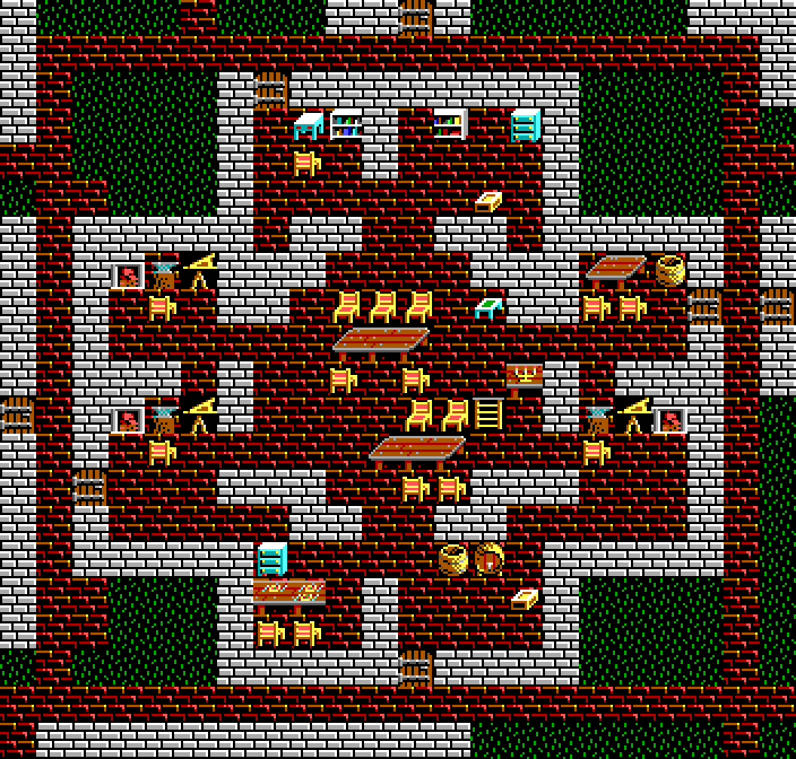

# Minoc: architecture and furnishing revision

This is a separate revision of the fresh 64×64 Ultima VII layout. Earlier studies
and `maps/Minoc.json` remain unchanged. There is still no town wall.



- [Full ground-floor preview](study/03-final-ground.png)
- [Upper floor](study/03-final-upper.png)
- [Final Workshop JSON](study/03-final.json)
- [Companion mod with arrival](study/Minoc-furnished.imperamod)
- [Homes](study/closeup-homes.png), [dormitories](study/closeup-dormitories.png),
  [shoreline](study/closeup-shore.png), [before/after comparison](study/comparison.png)
- [Shared Ultima V style guide](../../STYLE_GUIDE.md)

## Native examples first

The native Workshop probe exported all 32 original Ultima V locations, read-only,
from the existing game data. Every exported floor was counted. Ground-floor plans
were rendered together, with full-size Britain, Fogsbane and West Britanny examples
and an atlas covering all 512 DOS slots. No original game file was edited or
substituted for the authoritative Minoc export.

The [style guide](../../STYLE_GUIDE.md) links all evidence and the complete audited
terrain descriptions. Native examples contain 308 chairs, 264 complete beds, 38
dressers and 49 end tables, among many other fittings. Chair/table adjacencies
confirm the facing conventions: `90` north, `91` east, `92` south, `93` west.
These observations guide room functions and complete furniture assemblies; they
are not a requirement to scatter every available tile throughout a building.

## Factory plan and corners

The former arbitrary rectangle union is replaced by the supplied reference's
organization: a broad octagonal central work hall, paired northern rooms, paired
southern rooms, and upper/lower workshops on each side. Explicit partitions and
short passages separate the eight surrounding rooms from the work hall. At
64×64 scale these rooms are compact, rather than a pixel trace of Ultima VII.

The rooms have distinct jobs: ledger/office, tool storage, forging stations,
seated workbenches, break area and finished-stock stores. The open upper work
floor retains usable space around the original schedule destinations and ladder.
No new NPCs, dialogue, factions, quests or production mechanics were invented.

The previous corner bug classified floor using only cardinal neighbors. At concave
joints that could expose floor diagonally to grass. The new factory uses explicit
wall returns and eight-neighbor corner enclosure, with deliberate passages. Other
existing building joints receive matching caps where appropriate. Ordinary brick
walls stay `4f`; castle crenellation sprites are not misused as ground-floor
corners. All eight factory rooms and the hall pass conditional access checks.

## Furnishing, roads and shore

Across both floors, the revised city has **80 chairs, 23 dressers, 23 end tables and
10 mirrors**. Homes have bedside/storage groups and seated dining/work areas;
shops have counter seating and shelves; factories have operator places, benches
and stock; dormitories have modest shared storage and common tables. All complete bed pairs from the preceding layout are retained. Furniture is not placed on ladders, retained
quest containers, or impassable NPC destination cells.

Review caught two newly obstructed approaches: a bedside table behind the eastern
residence door, and a desk behind the harbor house door. The table was moved and
the small house's desk/chair arrangement was redesigned. The final doorway check
reports neither obstruction. Workshop and domestic furnishings now accompany
room function rather than leaving large rooms as one bed, one barrel or one table.

Main civic, commercial and industrial routes use continuous brick paving. Only
four explicit workers' housing spurs use connected native dirt-path components.
Two dormitory doors were repositioned as terrain to provide sensible dirt
approaches; existing gate/NPC/quest metadata was not altered. The bottom-center
arrival remains `(32,62)`.

**There is no desert tile `07` anywhere in the final map.** The shore uses
shallow-water edge cells, native directional grass/mud banks and ordinary grass
where there is no exact bank corner. The bay and the connected river geometry
are retained. Timber remains outdoors only on the explicit shipyard pier; paved
streets are deliberate streets, not unmarked interior-floor patches.

## Iterations and checks

The retained stages are [architecture](study/01-architecture-ground.png),
[furnishings](study/02-furnished-ground.png) and
[final roads/shore](study/03-final-ground.png). Full maps, house and factory details
were inspected and revised. The native survey and complete artwork atlas are
persistent references for future tasks.

[48 automated tests pass](study/test-results.txt). New checks cover closed factory
corners, conditional access to every room, furniture variety and complete beds,
paved main routes/dirt-only housing spurs, no desert shore, river preservation,
all original destination positions, upper-floor access, native survey coverage,
preview parity and deterministic replay. Earlier experiment regressions still pass.

All three stages pass the real Workshop importer, `Project::validate`, JSON
re-export terrain/metadata comparison and exact Python/C++ preview pixel comparison
on both floors. The companion mod passes resource/package roundtrip checks and
retains arrival `(32,62)` at Minoc's original Britannia entrance `(159,20)` without
changing the global new-game state. See [native evidence](study/native-validation.json).

The original 14 NPC records, schedules, conversations, signs, contents, type records
and artwork bytes remain unchanged. The authoritative source SHA-256 and prior-layout
SHA-256 are pinned by the recipe and recorded in `study/validation.json`.

There was no GUI import session or Impera play-test. Interior reachability remains
conditional on opening doors; static destination checks do not prove timed NPC
pathfinding, quest actions, locks, vehicles or save/reload behavior. Human review
should inspect the revised corners and rooms, then test those behaviors in game.

## Reproduce

```sh
python3 -m tools.city_design.experiments.minoc_furnished.design --output /tmp/new-minoc-furnished
python3 -m unittest discover -s tools/city_design/tests -v
```

Use new output directories. The style guide explains native survey reproduction;
the toolkit README explains building and running the real Workshop verifier.
Review branch: `ultima-ix-minoc-architecture`; PR base: `ultima-ix`, never `main`.
