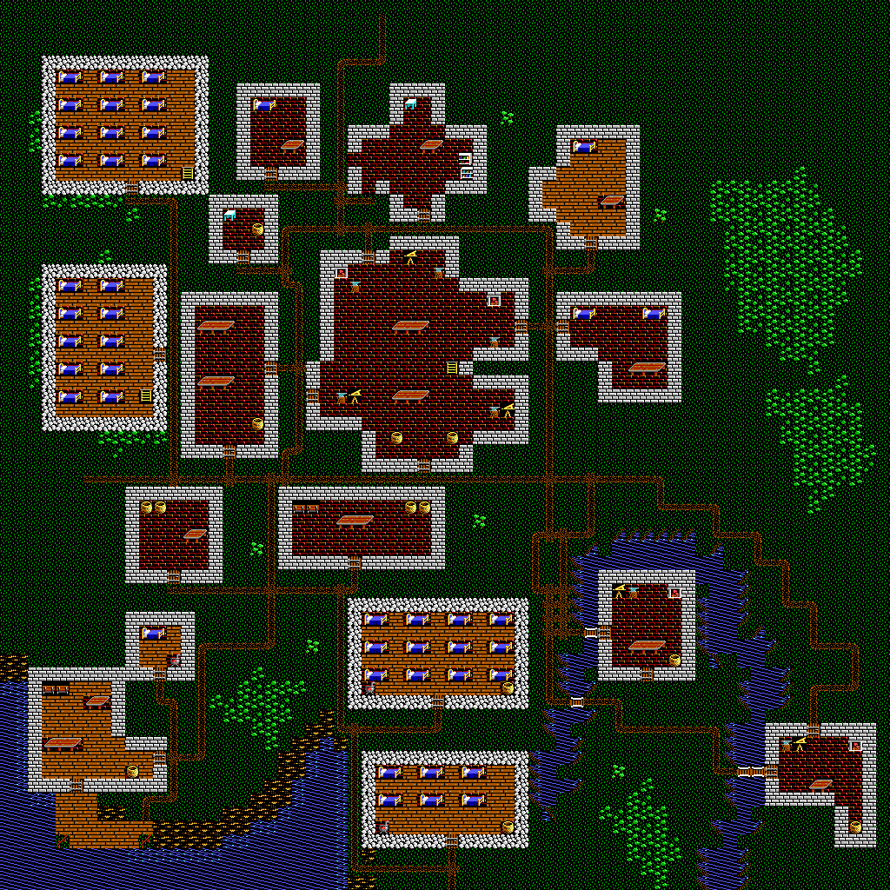

# Fresh Minoc: Ultima VII reference layout

A new **64×64 terrain study**, following the reference supplied in chat. It does
not extend or overwrite the earlier walled town. There is **no town wall**.



- [Final Workshop map JSON](study/04-final.json)
- [Companion mod with bottom-center arrival](study/Minoc-U7-layout.imperamod)
- [Upper floor](study/04-final-upper.png)
- [Waterfront](study/closeup-waterfront.png), [river](study/closeup-river.png),
  [central factory](study/closeup-central-factory.png),
  [southern dormitories](study/closeup-dormitories.png),
  [western loft dormitories](study/closeup-loft-dormitories.png)
- [Revision comparison](study/comparison.png)

## Reading the reference

The reference's spatial relationships drive the design, rather than the original
Ultima V town's building positions. The northern cottages and cross-shaped hall
lead into a cluster of workshops around the large central factory. A cross-town
lane separates that cluster from the southern workshops and open land. The
southwest building is the **shipbuilder**, on a sandy peninsula beside the bay,
with a timber pier and public quayside approach. The central building and both
southeast complexes are **factories**, furnished with workbenches, anvils, bellows,
hearths and storage. These are deliberate visual workspaces, not new game mechanics.

The southeast river has a northern pond/headrace around the first factory, a short
western spring arm, and a wider eastern outflow that continues off the south edge.
The bay and river are separate bodies of water inside this map, as in the reference.
Bridges span the channel at the factory approaches. The final underlying river is
one cardinally connected 83-cell water component, counting water beneath bridges;
no diagonal-only gaps or channel cells under factory floors remain.

Four new workers' dormitories occupy empty western and southern plots. They use
rough stone `0x4d`, rather than the regular brick wall `0x4f`, and rows of complete
`0xab/0xac` bed pairs with aisles. There are **62 beds** across ground floors and two
western lofts. Those lofts and the factory's upper work floor also fit preserved
NPC schedule positions without moving characters. No new NPCs or dialogue were
invented. Roofs cover other buildings on the second floor.

Ordinary yards and streets use grass, beach/earth and correctly connected native
path tiles. Interior brick/wood/stone flooring is confined to building footprints.
The explicit timber pier is the sole outdoor use of an interior flooring tile;
it is a waterfront structure, not an accidental floor patch in front of a factory.

This is an adaptation to 16×16 Ultima V artwork and 64×64 cells, not a pixel trace
of Ultima VII graphics. Narrow paths, shore banks, doorways and room footprints
necessarily differ at that scale. The supplied image remains the art-direction
reference; it has not been replaced with an invented alternate source image.

## Iterations and visual findings

1. [Initial layout](study/01-layout-ground.png): establish the reference's building
   masses, bay, river and two southern dormitories. Construction checks reject a
   road through the northern hall and an approach through water before export.
2. [Coast revision](study/02-coast-revised-ground.png): full-map and waterfront review
   show the shipyard needs a real peninsula and more beach, not walls directly in
   open sea. Broaden the sandy margin, provide a public pier approach, move an anvil
   blocking the central factory's eastern door, and add a third bed row in the
   northern of the two southern dormitories.
3. [River revision](study/03-river-revised-ground.png): close-up review and a component
   check expose three diagonal breaks in the narrow western arm. Replace them with
   continuous channel bends and remove water hidden under the factory footprint.
   Preserve road crossings with correctly oriented bridge artwork.
4. [Final integration](study/04-final-ground.png): retained NPC schedules initially
   land on walls or roofs. Add rough-walled loft dormitories in empty western plots
   and a usable factory loft, with three paired ladders. Shift the small northwest
   cottage one cell west, open two service passages in the northern hall and move a
   bookshelf. All old schedule destinations now have passable terrain. Original
   upper-floor containers receive trunk artwork in the new lofts, at unchanged
   coordinates. Recheck full maps, close-ups and upper-floor routes.

## Preservation and authorization

The user explicitly requested starting terrain **from scratch**, superseding the
previous study's protected terrain and town-wall rules for this experiment.
`maps/Minoc.json` remains untouched, with SHA-256
`878ab6e0d37afa44469758cbd0e75b1b22efc82f2919283b81a7623a5ae565a2`.
It supplies the authoritative artwork and metadata. Both original 32×32 terrain
regions are explicitly authorized for replacement; every final floor is 64×64.
The earlier experiment and its outputs are retained unchanged.

All 14 original NPC records, raw schedules, conversations, signs, contents, type
records and embedded artwork bytes are unchanged. No town-gate metadata is added.
The new terrain, rather than the records, is adjusted to accommodate old positions.
Static checks confirm the upper-floor destinations are reachable from the new
paired ladders. This does not prove time-dependent NPC behavior or quest continuity.
The original narrative identities and text have not been adapted to new jobs or
buildings; that is separate narrative work, not an implicit part of this layout.

The companion mod sets Minoc arrival to **(32,62)** while retaining the Britannia
entrance **(159,20)**. It changes neither the global new-game start nor the overworld
terrain. Location JSON does not carry portal arrival, so import the companion
`.imperamod` into a separate Workshop project for the complete arrival setting.
Do not apply it over later unreviewed edits without comparing them first.

## Validation

[39 automated tests pass](study/test-results.txt), including:

- exact metadata preservation, deterministic replay and original-source integrity;
- no town wall, no unintended outdoor floor tiles, complete rough-walled dormitories
  and 62 paired beds;
- one connected river, separate bay, south outflow and correct bridge cells;
- no blocked original schedule landing cells, paired ladders, reachable upper-floor
  destinations and retained container positions;
- door approach checks and nominated work-area/public-pier accessibility;
- native DOS preview rendering and the earlier toolkit regression suite.

All four revisions pass the **actual Workshop importer**, `Project::validate`,
re-exported terrain/metadata comparison and pixel-for-pixel C++/Python preview
comparison on both floors. Native movement bits match the catalogue. The companion
package was imported into a second private project; edited resources and arrival
survived, and global initial state remained unchanged. See
[native validation evidence](study/native-validation.json).

There was no GUI import session or actual Impera play-test. Interior routes depend
on opening doors; actors, clocks, locks, quest actions, bridge traversal, leaving and
re-entering town, and save/reload remain game-testing work. Static passability of
schedule destinations does not certify NPC pathfinding between times/floors.
Previews show terrain and furnishings, without NPC overlays, lighting or animation.

## Reproduce

From the repository root, with Pillow installed:

```sh
python3 -m tools.city_design.experiments.minoc_u7.design --output /tmp/new-minoc-u7
python3 -m unittest discover -s tools/city_design/tests -v
python3 -m tools.city_design.verify_workshop \
  --probe build/city-workshop-probe/city_workshop_probe --game 'Ultima 5' \
  --source maps/Minoc.json --study /tmp/new-minoc-u7 \
  --output /tmp/new-minoc-u7-native
```

Output directories must be new. The recipe pins the original export's hash. Native
probe setup is documented in the [toolkit README](../../README.md). Review this
fresh study on `ultima-ix-minoc-u7-layout`, targeting `ultima-ix`, never `main`.
